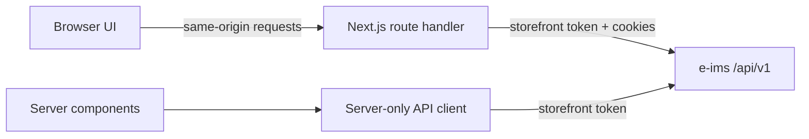

# Holier storefront API integration plan

This is the implementation backlog for connecting the `holier` Next.js storefront to the `e-ims` Laravel API at `/api/v1`.

## Current state

The storefront is a static prototype. Products, reviews, orders, and account data come from local fixtures; cart data lives in `localStorage`; wishlist data is in memory. Login, checkout, profile updates, social login, and several account actions only log or show an alert.

The earlier plan described `app/api/[...path]/route.ts`, `lib/api/*`, and `types/api.ts`, but those files have not been implemented.

## Evidence

- Frontend Codebase Memory index: `home-ai-www-holier`, indexed 2026-09-08.
- Backend index: `home-ai-www-e-ims` on `ai_staging`, indexed 2026-09-07.
- The backend route and controller files used below have no recorded indexing gaps. Coverage is best-effort, so their route source was also checked.

## Target architecture



- Keep `STOREFRONT_TOKEN` on the Next.js server.
- Server components call the backend through one server-only client.
- Browser mutations use a same-origin proxy that forwards cookies and `Set-Cookie`.
- The backend owns prices, stock, taxes, promotions, shipping, and totals.
- Map API DTOs once at the boundary, not independently inside components.

## Backend API inventory

| Area | Available endpoints | Current frontend |
| --- | --- | --- |
| Products | `GET /products`, `GET /products/{id}`, `GET /products/{id}/variants`, `GET/POST /products/{id}/reviews` | `data/products.ts`; review display only |
| Discovery | Product categories and brands, including detail endpoints | Static filters; no brand browsing |
| Product query | `q`, `category_id`, `brand_id`, pagination, and supported sorting | Inert search; fixture-only filters |
| Cart | `GET/DELETE /cart`, item add/update/delete, `POST /cart/merge` | `localStorage` only |
| Wishlist | `GET /wishlist`, add/remove, move to cart, merge | In-memory IDs only |
| Customer | Auth/recovery/social exchange, profile, password, addresses, payment methods, logout | Placeholder/static UI |
| Shipping | `GET /shipping/addresses` with configured locations and charges | Hard-coded delivery copy |
| Orders | Authenticated list/create/detail; guest create and token-protected lookup | Fixture history; fake checkout success |
| Promotions | `GET /flash-sales/active`; promotion summary in product resources | Static sale content |
| Coupons | No active storefront route found | Misleading coupon input |

Paths are relative to `/api/v1`.

## Phase 1: API foundation and catalog

- [x] Add `.env.example`:

  ```env
  BACKEND_API_URL=https://app.ims.test/api/v1
  STOREFRONT_TOKEN=
  ```

- [x] Generate a tenant token with `php /home/ai/www/e-ims/artisan tenants:storefront-token <tenant> --name="Holier Storefront"`.
- [ ] Trust the local yerd CA before starting Next.js: `NODE_EXTRA_CA_CERTS=/home/ai/.local/share/yerd/ca.cert.pem npm run dev`.
- [x] Add `lib/api/server.ts` for server-only requests, token injection, timeouts, and normalized errors.
- [x] Add `app/api/[...path]/route.ts`; forward method, query, body, content type, cookies, `Set-Cookie`, client IP, backend status, and error bodies.
- [x] Add `types/api.ts` and `lib/api/mappers.ts`; only add types/mappers needed by the current phase.
- [x] Fetch products, detail, categories, brands, variants, and reviews.
- [x] Replace fixture products in home, featured sections, product showcase, shop, and product detail.
- [x] Back `/shop` with URL parameters: `q`, `category_id`, `brand_id`, `sort`, and `page`.
- [x] Use `sort=-created_at` for `/new-arrivals` and categories/brands for `/collections`.
- [ ] Back `/sale` with active flash-sale/promotions. Blocked by `GET /flash-sales/active` returning `500 Session store not set on request`.
- [x] Accept backend UUIDs or slugs in product URLs and types; remove `Number(id)` coercion.
- [x] Preserve backend variant IDs, options, prices, and stock; fetch and display reviews.
- [x] Add loading, empty, error, and not-found states.

Done when no production catalog, price, stock, or review data comes from `data/products.ts` or `data/featuredProduct.ts`, and the backend flash-sale error above is fixed.

## Phase 2: cart and wishlist

- [x] Replace `CartContext` local calculations with backend cart responses.
- [x] Persist and send the backend guest cart token.
- [x] Use backend cart-item and variant IDs for update/remove actions.
- [x] Display backend prices, taxes, promotions, availability, and totals.
- [x] Merge the guest cart after login and surface duplicate/stock errors.
- [x] Replace `WishlistContext` memory state with backend responses.
- [x] Implement add, remove, move-to-cart, and guest-token persistence.
- [x] Merge the guest wishlist after authentication.
- [x] Delete unused `hooks/useWishlist.ts` after migration.

Done when cart and wishlist survive refresh, merge after login without duplicates, and do not trust restored product objects.

## Phase 3: authentication and account

- [x] Implement register, login, logout, session bootstrap, forgot password, and reset password.
- [x] Implement the configured Google provider, including redirect/callback/exchange.
- [x] Replace alerts/logs with pending states, field errors, backend messages, and navigation.
- [x] Implement profile update, password change, and confirmed account deletion.
- [x] Load and delete customer addresses.
- [x] Add/edit addresses and select billing/shipping defaults using `GET /shipping/addresses` location IDs.
- [x] Load paginated order history and add `/order/[id]` for authenticated order detail.
- [ ] Include order items in `GET /order/{id}`; the backend detail query currently does not load `orderItems`.
- [x] Load the real wishlist in the account dashboard.
- [x] Allow authenticated review submission with 0.5-step ratings.
- [x] Remove fake share, download, delete, and update actions without contracts.

Done when `data/account.ts` is unused at runtime and customers see only their backend profile, addresses, wishlist, and orders.

## Phase 4: checkout and confirmation

- [x] Load payment methods from `GET /customer/payment-methods`.
- [x] Load shipping locations/charges from `GET /shipping/addresses`.
- [x] Submit authenticated checkout with billing address, shipping address, and payment method IDs.
- [x] Submit guest checkout with contact/address objects, payment method ID, and guest cart token.
- [x] Reprice immediately before submission; show validation, stock, payment, and network errors.
- [x] Prevent duplicate submissions and clear cart only after success.
- [x] Redirect authenticated orders to `/order/[id]`.
- [x] Add `/order/guest/[orderNumber]` using the returned `guest_access_token`; retain it only while confirmation lookup needs it.

Done when checkout uses current backend totals/shipping, repeated clicks cannot duplicate UI requests, and guest lookup requires its token.

## Phase 5: cleanup

- [x] Delete `data/products.ts`, `data/account.ts`, and `data/featuredProduct.ts` after their last runtime import is removed.
- [x] Remove the coupon box until validate/apply/remove endpoints exist.
- [x] Remove hard-coded delivery claims unless confirmed by shipping data.
- [x] Remove/unlink missing footer routes (`/contact`, `/shipping`, `/returns`, `/size-guide`, `/faq`, `/about`, `/privacy-policy`, `/terms`) or add intentional static pages.
- [x] Remove remaining logs, fake success alerts, and placeholder commerce links.
- [x] Verify every visible action calls a real API or is honestly disabled.

## File map

| File or area | Action |
| --- | --- |
| `.env.example` | Add backend URL and blank token variables |
| `app/api/[...path]/route.ts` | Add browser-to-backend proxy |
| `lib/api/server.ts` | Add server-only client |
| `lib/api/mappers.ts`, `types/api.ts` | Add boundary mapping and DTOs incrementally |
| Home/catalog/product components | Replace fixtures; add search, filters, variants, stock, reviews |
| `CartContext`, cart page | Use backend cart and totals |
| `WishlistContext`, account wishlist | Use backend wishlist and merge |
| `AuthForm` | Implement auth and recovery |
| `AccountDashboard` | Implement profile, password, addresses, wishlist, and orders |
| `Checkout` | Create authenticated or guest orders |
| `hooks/useWishlist.ts` | Delete after migration |
| Fixture data files | Delete after runtime migration |

## Backend contracts required before exposing UI

- Coupon validation/application/removal.
- Return or exchange requests and status.
- Order cancellation.
- Receipt or invoice download.
- Newsletter subscription.
- CMS-managed help, legal, and about content.
- A distinct collections resource, if collections differ from categories or brands.

Do not add a client state library, query library, or generated SDK for this work. Next.js server fetching and the existing React context boundary cover the current scope.
